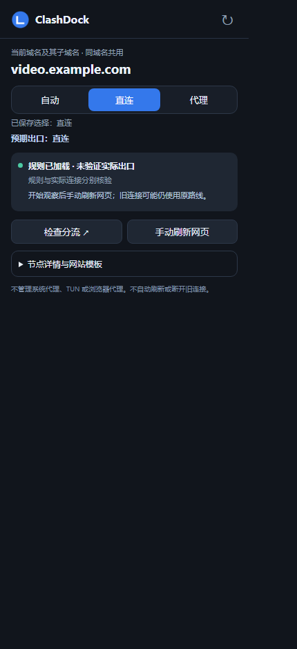

# ClashDock v1.2.0 使用手册

**适用对象：只想下载使用、不需要了解代码的用户。**

ClashDock 帮你给常用应用和网站选择“自动、直连、代理”。它使用你电脑上已运行的 Clash Verge / Mihomo，不附带节点、订阅，也不是独立 VPN。设置只对已经进入 Clash 的流量有效。

[下载与解压](#download) · [三分钟开始](#start) · [按钮在哪里](#map) · [应用](#apps) · [网站](#sites) · [Edge 扩展](#edge) · [看懂状态](#status) · [检查分流](#inspect) · [常见问题](#faq) · [更新与卸载](#maintenance)

## 1. 下载与解压

1. 打开 [v1.2.0 正式发布页](https://github.com/LeoLi006/ClashDock/releases/tag/v1.2.0)。
2. 在 **Assets（附件）** 下载 **`ClashDock-1.2.0-win-x64.zip`**。这是可以直接使用的便携包。
3. 右键 ZIP → **全部解压缩**，放在你准备长期保留、能够写入的目录。
4. 打开解压后的文件夹，双击 **`ClashDock.exe`**。不需要安装 .NET 或开发工具。

**不要下载 `Source code (zip)` 当成软件，也不要在压缩包内直接运行 EXE。** 本版本面向 Windows 10 / 11 的 x64 电脑，不提供原生 ARM64 构建。

可选校验：同时下载发布页的 `SHA256SUMS.txt`，在 PowerShell 运行 `Get-FileHash .\ClashDock-1.2.0-win-x64.zip -Algorithm SHA256`，与清单中 ZIP 同名一行核对。大小写无关；不一致时停止运行并重新下载。无需为校验安装额外软件。

| 解压后看到的内容 | 是否需要操作 |
|---|---|
| `ClashDock.exe` | 主程序，双击打开 |
| `ClashDock.Bridge.exe` | Edge 通信桥，不要单独双击 |
| `EdgeExtension` | Edge 加载扩展时选择这个文件夹 |
| `BridgeTools` | 通信桥维护脚本；普通用户优先用桌面内的注册入口 |
| `使用手册.html` | 离线手册，双击在浏览器阅读 |
| `开始使用.txt` | 最简上手步骤 |
| 许可证、校验清单和其他说明 | 保留即可 |

Windows 如果提示无法验证发布者，本版本没有商业代码签名证书。请先核对下载来源及 SHA-256；不要关闭系统防护或绕过单位策略，不确定时停止运行。

## 2. 三分钟开始

### 第一步：准备好 Verge

先打开 Clash Verge / Clash Verge Rev，确保已有可用订阅或节点。建议使用支持全局扩展脚本的 Clash Verge Rev。ClashDock 默认自动读取其本机连接配置，一般不用填写端口、密钥或程序路径。

**请在 Verge 自行选择“规则（Rule）”模式。** 全局（Global）模式不会按网站直连规则分流；ClashDock 不替你切换运行模式、系统代理或 TUN。

应用流量需要已经通过系统代理、应用自身代理设置或你自行配置的其他方式进入 Clash；ClashDock 不强制接管未使用代理的软件。

### 第二步：给一个常用应用设置模式

打开 ClashDock → 左侧 **应用规则** → 搜索应用名 → 在右侧模式中选择 **直连** 或 **代理**。选择代理前，先在窗口上方选好代理目标。

修改会自动保存，短暂等待后串行应用，**不用每天点“重新应用全部分流”**。添加、删除和修改目标也可能影响实际分流，请在确认需求后操作。

### 第三步：看结果

等待底部显示 **规则已加载**。这说明规则和相关策略组已被内核接受，**不等于已测出公网出口**。

如果要进一步确认，选中该条目 → **检查分流** → **开始观察 15 秒**，然后手动操作应用或刷新网页。没有检测到连接不代表应用未联网。

## 3. 按钮在哪里

| 想做什么 | 从哪里进入 |
|---|---|
| 设置应用自动／直连／代理 | 左侧 **应用规则** → 右侧模式 |
| 找不到应用，重新发现 | **应用规则 → 扫描应用** |
| 加入便携程序 | **应用规则 → 手动补充**，选择 EXE |
| 常用应用置顶 | 应用名称旁 ☆；或右键应用 → **置顶** |
| 为网站设置分流 | 左侧 **网站规则 → 添加网站** |
| 一次添加常用站点资源域名 | **网站规则 → 常用站点** |
| 改节点或策略组 | 顶部 **代理目标** |
| 看延迟或测速 | 顶部 **测速 / 刷新**；或右上 **目标状态** |
| 看真实命中记录 | 选中应用／网站 → **检查分流** |
| 检查／注册 Edge 通信桥 | **设置与说明 → Edge 通信桥检查／注册…** |
| 处理失败后重新恢复分流 | 底部 **重新应用全部分流**，先看预览再确认 |
| 暂时停用本工具的分流 | 右下角托盘图标右键 → **暂停分流** |
| 完全退出工具 | 托盘右键 → **退出（保留已生效规则）** |

关闭主窗口或按 Esc 会回到托盘；再次双击 EXE 可唤起已有窗口。找不到托盘图标时，可展开 Windows 右下角“显示隐藏的图标”。

## 4. 应用规则怎么选

| 选择 | 含义 |
|---|---|
| 默认 | 没有单独设置，使用“未单独设置的应用”的默认行为 |
| 自动 | 明确沿用订阅规则；即使默认行为改为直连，也排除此应用 |
| 直连 | 匹配到且已进入 Clash 的流量使用 DIRECT |
| 代理 | 匹配到的流量使用顶部选择的节点／策略组 |

**推荐起步：保留“沿用订阅规则”作为默认，只设置少量确有需要的应用和网站。**

- 搜索支持名称或路径，悬停可看完整路径。搜索、扫描和星标置顶不会改变网络规则。
- ☆ / ★ 只保存显示偏好。搜索不匹配时，置顶应用也会隐藏。
- **恢复默认**会撤销所选应用的独立设置，并自动应用。
- 应用移动或重装后路径可能变化，需要重新补充；第一版置顶不支持拖拽排序。

“设置与说明 → 未单独设置的应用”可选择“沿用订阅规则”或“未单独设置的应用全部直连”。后一项是较大范围的默认行为变化，第一次使用不必改它。

## 5. 网站规则怎么设

1. 左侧 **网站规则 → 添加网站**，输入域名或 HTTP/HTTPS 网址。
2. 为新增条目选择自动、直连或代理。
3. 等待规则核验；必要时用“检查分流”观察新连接。

匹配范围是 **输入的域名及其子域名**。例如 `example.com` 包含 `video.example.com`，而单设 `video.example.com` 不会自动扩大到整个 `example.com`。URL 后面的路径不用于区分规则。

规则优先顺序：**更具体的网站域名 → 其他网站规则 → 应用规则 → 默认行为／原订阅规则**。同域名的所有标签页共用设置，也会影响其他应用访问该域名。

- 双击网站名称可编辑域名；移除条目或改成自动会自动应用撤销。
- “自动”撤销当前域名的覆盖，但仍可能命中你设置的父域名规则。
- 一个网页可能请求多个资源域名。只设置主站，不保证它引用的其他域名都走同一路线。
- “常用站点”先预览和编辑域名，再添加。资源域名可能被其他网站共用，不要不看列表就批量改。

## 6. 安装 Edge 扩展：只做一次

扩展是可选的。不安装也能在桌面设置网站规则。它不控制 Edge 的全局代理，也不能做到同域名不同标签页分别代理。

### 6.1 注册桌面通信桥

1. 保留便携包内两个 EXE、`EdgeExtension` 和 `BridgeTools`，不要拆开放。
2. 打开 ClashDock → **设置与说明 → Edge 通信桥检查／注册…**。
3. 先看只读检查结果，再点 **注册／修复当前安装**并确认。
4. 文件、清单、HKCU 和固定来源检查应通过。**安装检查通过还不等于浏览器已连接。**

注册只涉及当前用户和当前安装目录，通常不需要管理员权限。不要更改浏览器安全策略来绕过单位限制。

### 6.2 在 Edge 加载扩展

1. 在 Edge 地址栏打开 `edge://extensions`。
2. 开启页面上的 **开发者模式**。
3. 点击 **加载解压缩的扩展**，选择便携包中的 **`EdgeExtension` 文件夹**，不是整个 ClashDock 文件夹。
4. 核对扩展 ID 为 `opbdfefdnighegepeiffmioofdkkphnk`，并把它固定到工具栏。
5. 打开普通 HTTP/HTTPS 网页，点击工具栏上的 ClashDock 图标。

如果你无法开启开发者模式或加载扩展，请遵循设备管理策略；不要安装来源不明的替代扩展。扩展不会读取网页正文、密码、表单或完整浏览历史。

### 6.3 日常使用

- 顶部是当前域名，三个按钮表示保存的选择。
- **预期出口**表达你的意图；**规则已加载**表达内核核验结果，二者都不是公网 IP 实测。
- 直连时显示“预期出口：直连”。代理节点及延迟放在 **节点详情与网站模板**内，表示“选择代理时使用”。
- **手动刷新网页**由你决定；工具默认不刷新，避免丢表单。
- **检查分流 ↗**打开桌面只读面板，再由你主动开始短时观察。
- 更新便携包后，到 `edge://extensions` 对 ClashDock 点击 **重新加载**，关闭旧弹窗再打开。

查看扩展示意图（使用示例域名，不含个人数据）

想用脚本维护安装，或排查固定 ID、来源与注册路径，请看 [扩展安装指南](EDGE_EXTENSION.md)。日常使用无需执行命令。

## 7. 看懂状态，再决定下一步

| 界面状态 | 当前能确认什么 | 下一步 |
|---|---|---|
| 等待应用 | 修改已保存，正在防抖或排队 | 稍等，不要重复点击 |
| 正在应用 | 正在提交并读回核验 | 等待结果，可继续修改，最终按最后选择处理 |
| 已保存但未生效 | 保存了意图，尚未确认最新修改进入内核 | 核对后按需重新应用，不当成成功 |
| 规则已加载 | 托管规则及所需策略组已通过核验 | 需要时主动观察新连接 |
| 应用失败 | 修改未确认生效，选择保留 | 点击桌面状态看完整原因，修复后再重试 |
| 保存失败 | 未确认落盘，不是已保存 | 检查目录写入权限，不要直接删除配置 |
| 控制器未连接 | 无法完成当前核验 | 先确认 Verge 运行，再检查高级连接 |
| 当前模式不按规则分流 | Global 等模式绕过规则 | 在 Verge 自行核对 Rule 模式 |
| 托管规则缺失或变化 | 当前配置与预期不符 | 先核对 Verge，再预览恢复 |
| 目标失效／策略组变化 | 所选目标消失或组被改选 | 在顶部重选或核对组选择，不会自动换节点 |
| 已暂停 | 本工具的托管规则已撤下 | 需要时从托盘恢复 |

**重新应用全部分流不是“只重试这个网站”。** 点击后会显示应用／网站规则数量、默认行为和影响范围；确认才执行，取消不会应用。可能重载配置并影响连接，不要当刷新按钮反复点。

桌面重启、扩展重连、过期响应不会自动重放未知结果的修改；工具也不会与 Verge 无限争抢配置。

## 8. 用“检查分流”排查问题

1. 在桌面选中应用或网站，点 **检查分流**；Edge 也有入口。
2. 先看顶部结论和“下一步”，再看控制器、模式、保存意图和托管规则核验。
3. 要查实际请求时，点 **开始观察 15 秒**。
4. 在这 15 秒内手动刷新网页，或让应用进行一次联网操作。
5. 展开 **进程／域名／规则／链路详情**，看是否命中预期规则和 DIRECT／代理组。

停止或关闭窗口立即取消，不会永久抓取。应用优先按完整路径匹配；缺少路径时仅列“名称候选，未精确确认”。网站按完整域名边界匹配，不会把 `notexample.com` 当成 `example.com`。

没有记录只表示本次采样尚未检测到，极短连接也可能漏过。链路里的节点名不是公网 IP；工具不会自动请求外部 IP 服务，也不会替你断开所有旧连接。

## 9. 常见问题：按症状找答案

### 已选直连，网页为什么还显示代理 IP？

依次检查：是否仍在 Global 模式 → 状态是不是“规则已加载” → 当前域名是否就是查 IP 的域名 → 是否复用了旧连接。把 A 站设直连，再到 B 站查 IP，测到的是 B 站的路线。必要时用“检查分流”观察一次新请求；旧页面不自动刷新。

### 显示“规则已加载”，是不是保证应用已经直连？

不是。它只确认配置层；应用还必须使用 Clash，域名／进程必须匹配，并且新请求实际命中对应规则。用主动观察补充证据。

### 找不到应用？

先清空搜索，点“扫描应用”。便携程序可“手动补充”选择 EXE。应用移动或重装后原路径可能失效。

### 控制器未连接，必须手填端口吗？

先打开 Verge。默认安装位置通常可自动识别。自定义配置目录可在“设置与说明”指定；只有自动识别失败才进入“高级连接配置”。密钥仅填本机窗口，不发到 GitHub Issue 或截图中。连接配置保存后按窗口提示重启 ClashDock。

### 显示“未找到 Verge 全局扩展脚本”？

当前 Verge 配置需要支持并初始化全局扩展脚本。先在 Verge 核对这一功能，别用手改订阅文件来绕过检查。不支持该配置结构的客户端不能保证兼容。

### 显示“配置被覆盖”或“非托管规则不一致”？

先在 Verge 核对并重新生成／应用你想使用的订阅，确认当前配置正确，再回 ClashDock 预览“重新应用全部分流”。工具拒绝不一致是为了保留原规则；不要删除配置或无限重试。

### 扩展提示找不到通信桥？

确认四个主要文件／目录相邻，打开桌面“Edge 通信桥检查／注册”。根据具体层级修复当前安装，再核对扩展 ID。不要把所有错误都当成未注册，也不要无依据关闭浏览器。宿主退出、来源拒绝或超时会保留原始错误供排查。

### 扩展提示未连接桌面？

保持 ClashDock 运行。桥已经注册时，可点击扩展内的“启动 ClashDock”；若桥本身缺失，先完成桌面注册。浏览器请求历史附带时间，仅供回看，不保证当前仍连接。

### 同一域名两个标签页能分别代理吗？

不能。网站规则是内核的域名规则，也可能影响其他应用访问同域名；不是标签页独立代理。

### 为什么校园网认证仍打不开？

直连不保证能解决认证。认证还可能涉及 DNS、路由和系统现有代理配置。本版本不管理 TUN，不猜学校地址，也不保存校园网密码。

## 10. 更新、备份、暂停与卸载

### 更新到新版本

1. 从 GitHub Release 下载新的便携包，先解压到另一个目录。
2. 从托盘退出旧 ClashDock，等待正在进行的修改结束。失败或保存错误先处理，别直接覆盖。
3. 备份旧目录；复制新 EXE、扩展、脚本和说明到原安装目录，**保留原有个人配置文件**。
4. 重新打开 ClashDock；如果使用 Edge 扩展，在扩展页点“重新加载”。
5. 打开通信桥只读检查。整个目录换位置时，应先从旧目录卸载注册，再在新目录注册；不要只移动一个 EXE。

个人数据文件包括 `settings.json`、`routing-intent.json`（若存在）、`routing-intent.json.undo` 和 `ui-preferences.json`。它们只在本机产生，正式便携包不携带任何人的这些文件。备份是私有的，不要上传整个安装目录或分享个人文件。

### 暂停和退出有什么不同？

- **关闭窗口／Esc**：回到托盘，程序继续运行。
- **退出**：停止工具，已安装的规则仍保留。
- **暂停分流**：撤下 ClashDock 管理的规则，保留原订阅和恢复意图。
- **恢复分流**：重新应用保存的意图，会影响实际网络。

### 不再使用

1. 如果要撤销分流，先到 **设置与说明 → 移除全部托管规则**，确认并等待结果。这会改变实际分流，不只是删除软件。
2. 若用过 Edge 扩展，从当前安装的 PowerShell 运行 `BridgeTools/Unregister-Bridge.ps1`，或按扩展指南卸载当前用户注册；然后在 Edge 扩展页移除扩展。
3. 托盘退出后，再按需删除便携目录。需要保留个人设置时先做私有备份。

不要只删除 EXE 并假定规则已经撤销。不要把本工具的“移除托管规则”当成清空整个订阅。

## 11. 反馈问题与已知限制

提问前先看状态及“检查分流”。[提交 Issue](https://github.com/LeoLi006/ClashDock/issues) 时说明软件版本、Windows 版本、操作步骤、期望与实际结果；截图遮住密钥、订阅链接、个人路径和私人网站。不要附完整个人配置或完整连接列表。

本版本未强制接管所有特殊进程，不提供每网站独立节点、标签页独立代理、TUN 管理、自动断开旧连接或公网 IP 实测。订阅更新后可能需要重新核验；极短连接可能漏采。

详细技术与验证边界见 [开发说明](DEVELOPMENT.md)、[验证记录](VALIDATION.md) 和 [第三方声明](THIRD_PARTY_NOTICES.md)。

## 开发版：工具栏与侧边栏（2026-11-06，尚未制作新版 Release）

在 Edge 扩展管理页重新加载当前安装的 `publish/EdgeExtension`，如浏览器要求，请确认新增权限。扩展 ID、公钥、本机通信桥注册均保持不变。无需重新注册通信桥。

- **工具栏弹窗**：适合快速改一次选择。点击网页、翻译提示等外部界面后，浏览器会自动收起弹窗，这是正常行为，不能强制保持。
- **侧边栏**：在弹窗顶栏点“侧边栏 ↗”，适合一边操作网页一边查看状态。用 Edge 侧栏自己的关闭按钮收起；不会自动打开或关闭其他网页。
- 两种界面共用桌面规则、通信协议、状态读取与自动应用队列。重新打开仅同步状态，不重放上次修改。桌面已经接收的修改继续由桌面处理；尚未收到确认的请求不能当成保存成功。
- 侧栏跟随**打开它的浏览器窗口**中的活动标签页。先确认顶端域名再操作；切换标签页时未提交的选择会清除，旧响应会丢弃，已提交操作仍针对原域名。
- 自动／直连／代理表示保存意图；“规则已加载”只表示规则核验，实际连接需在“检查分流”中主动观察。直连显示“预期出口：直连”，不是公网 IP 验证。
- 延迟、时间、目标和模板在折叠详情里；“重新应用全部分流”需确认全部规则数量及影响，绝非只重试当前网站。手动刷新可能丢失网页表单，请自行确认。
- Tab 移动焦点，方向键／Home／End 在模式按钮间移动，Enter 或空格执行；方向键本身不会修改规则。

新增 `sidePanel` 用于浏览器原生侧栏，`tabs` 用于跨标签页识别当前 URL。未增加网页注入、网页正文、密码、表单、代理控制或历史记录权限；不收集或保存浏览历史。旧版 Edge 若不支持 Side Panel API，按钮不可用，请保留工具栏方式或自行更新浏览器。

侧栏展示和翻译浮层共存依赖 Edge 自身实现；已通过独立 Edge 的真实侧栏 API、DOM 渲染与只读通信验证，用户日常配置中的翻译提示交互仍需手动体验。不会为测试关闭你的浏览器。
